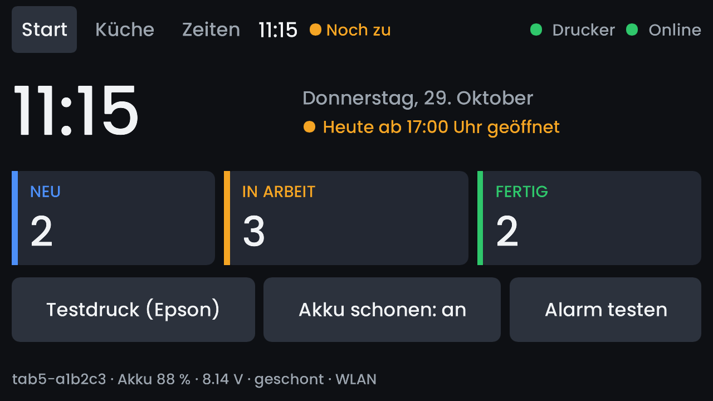
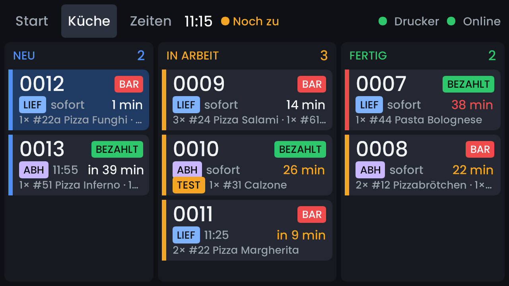
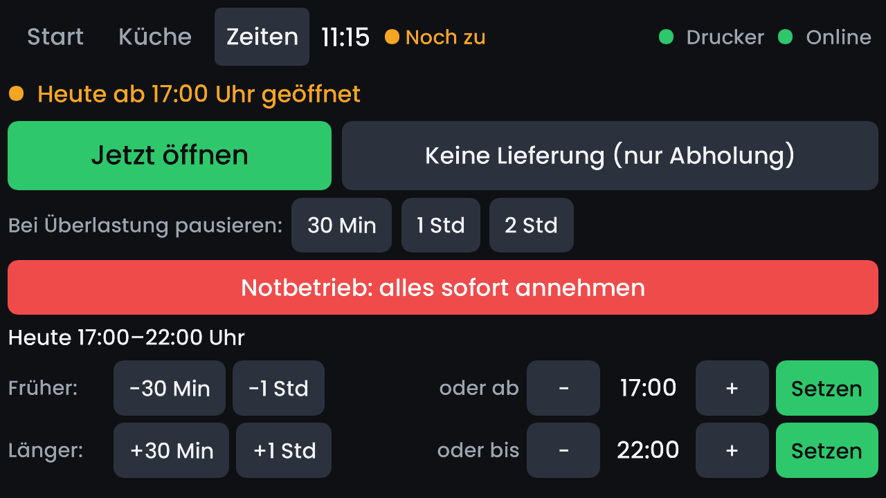

# Kitchen display — M5Stack Tab5 (ESP32-P4)

The kitchen screen and the receipt printer client on an M5Stack Tab5:
5" 1280×720 touch panel, speaker, battery, USB-A host for the Epson.
Rust std on ESP-IDF 5.4.4 (`riscv32imafc-esp-espidf`), outside the cargo
workspace.

**The screen is built with [Slint](https://slint.dev).** One `.slint` file,
[`crates/kds-ui/ui/kitchen.slint`](../kds-ui/ui/kitchen.slint), with the
shared logic in `kds-ui`, runs on three devices:

| Device | Slint setup |
|---|---|
| M5Stack Tab5 (ESP32-P4) | MCU mode, software renderer, fonts pre-rendered as signed distance fields |
| STM32MP135F-DK (Linux) | software renderer on KMS, the board's 480×272 touch screen |
| Browser (`/kitchen/display`) | WebAssembly, WebGL |

### Start

Clock, opening state, the three columns at a glance, and the Tab5's own
buttons: test print, battery care, alarm test.



### Küche

The board: new, in progress, ready. A tap moves an order on; waiting times
turn amber and red, pre-orders count down to their time.



### Zeiten

The shop's opening hours from the kitchen: open now, delivery off, pause
when overloaded, emergency mode, today's hours earlier or later.



The pictures show the demo orders, drawn by the same renderer and fonts as
on the device:

```bash
cd crates/kds-ui
KDS_UI_SCALE=2.647 cargo run --release --features mcu --example screenshots -- ../kds-tab5/screenshots
```

## Overview

| Part | How |
|---|---|
| Live orders, taps | `/api/kds/feed` + `/api/kds/action`, like the browser mirror |
| Printing | `/api/kitchen/ws`; a USB printer on the USB-A port prints and acks every job, no printer → nothing printed or acked |
| Login | Küche password → `dp_session` + `dp_auth` cookies (all Set-Cookie headers kept) |
| Network | Wi-Fi via the ESP32-C6 coprocessor; Ethernet (W5500) planned, see below |

## Build and flash

```bash
# credentials, never committed: tmp/tab5-wifi.env (KEY=VALUE, read literally)
#   WIFI_SSID / WIFI_PASS, WIFI2_… … WIFI5_…   up to five networks
#   KITCHEN_PASSWORD                            the shop's Küche password
#   SHOP_URL                                    default https://davidspizzeria.de
#   KITCHEN_SLUG                                optional fixed device name; without it each
#                                               Tab5 names itself tab5-<last 3 MAC bytes>
PROFILE=release scripts/build_kds_tab5.sh flash     # build + flash + short monitor
SECS=60 scripts/build_kds_tab5.sh monitor            # log only
RESET=1 SECS=30 scripts/build_kds_tab5.sh monitor    # restart, then log
```

Always flash the release build (≈4.9 MB image with the logo renderer, SDF
fonts + LTO). Changing `sdkconfig.defaults` or the components in
`Cargo.toml` needs `cargo clean -p esp-idf-sys --release` first.

The firmware reports its version as
`<crate version>-<commit>[-dirty]-<YYYYMMDD-HHMM>` (`ota::VERSION`, set by
the script): every build carries its build time, USB builds too.

## 7" board: Guition JC1060P470

The same firmware on Guition's 7" JC1060P470 (ESP32-P4 rev v1.3, 1024×600
JD9165 panel, GT911 touch, IP101 Ethernet, ESP32-C6 for Wi-Fi, no battery):
the same screen, about 1.4× larger (KDS_UI_SCALE 2.133).

```bash
BOARD=jc1060p470 PROFILE=release scripts/build_kds_tab5.sh flash
BOARD=jc1060p470 PROFILE=release scripts/build_kds_tab5.sh stage   # update slot esp32p4-jc1060p470
```

- **Build:** cargo feature `jc1060p470` (set by the script), the board
  package in `boards/jc1060p470/bsp` (C, Espressif's board-package function
  names, so display, touch and USB printing are shared Rust code), its own
  sdkconfig on top of the shared one, its own component list and target dir
  (`target/jc1060p470`). Board-specific Rust: `src/jc1060p470/`.
- **Network, chosen at start by the cable:**
  - **LAN mode** (a cable, and an address from DHCP): the cable is the uplink,
    and the board runs the shop's hotspot through the C6 — the STM32 board's
    network: `HOTSPOT_SSID` / `HOTSPOT_PASS` from `tmp/tab5-wifi.env`
    ("rusterando"), 192.168.72.1/24, DHCP, NAT to the LAN. A Tab5 joins it
    with what it already knows.
  - **Wi-Fi mode** (no cable): a Wi-Fi client like the Tab5, no hotspot. A
    cable plugged in later restarts the board into LAN mode.
- **Updates:** reports arch `esp32p4-jc1060p470`, its own update image —
  a Tab5 image is never offered to it. Device name `jc1060-<last 3 MAC bytes>`.
- **Panel:** Guition ships two panels behind the JD9165 ("V2" after the
  material number on the rear label = the newer one). The init table is
  the V2 one, read out of the factory firmware; a V1 panel needs another.
  Clocks: 48 MHz pixel clock with 720 Mbps DSI lanes, so ESP-IDF 5.4.4's
  pixel → lane-clock conversion is exact — with Guition's 52 MHz / 750 Mbps
  it truncates, and the whole picture flickers (details in
  `boards/jc1060p470/bsp/src/bsp_display.c`).
- **Gong:** ES8311 codec and NS4150 amplifier are on board and set up
  (`bsp_audio.c`, the Tab5's `gong.rs`), but no speaker comes with it: plug
  one (e.g. Waveshare "2030 Cavity Speaker (B)", 8 Ω 2 W, 2-pin PH1.25)
  into the MX1.25 socket **left of the micro-SD slot** — the one right of it
  is the lithium battery input. "Alarm testen" on the Start page plays it.
  No Bluetooth speaker: the C6 does Bluetooth LE only, speakers need
  Classic Bluetooth (A2DP).
- **USB printer:** the "high-speed" USB-C port (USB host), with an OTG
  adapter or a C-to-B cable; flashing and the console use the other one
  (from the schematic, not tested with a printer yet).
- **Factory firmware:** verified backup in `tmp/p4-7-backup/` (restore
  steps in its README).

## Updates over the network

```bash
PROFILE=release scripts/build_kds_tab5.sh stage
# → <DEPLOY_REMOTE_BASE>/artifacts/printer/esp32p4/{rusterando-printer,version}
#   on SSH_HOST (from .env.davids, or STAGE_ENV=<file>)
```

Then arm the device on **/admin/drucker** (the same switch as for the STM
board; the page shows the staged version). On its next connect, or within
20 s while connected, the server offers the image over the print channel;
the Tab5 fetches it in 48 KB chunks into the other app slot, checks size
and SHA-256, restarts into it and reports the result (shown on the admin
page, disarmed either way).

**Only newer builds are offered.** One image is staged for all Tab5s; a
device running a later build (e.g. flashed over USB after the staging)
shows "neuer als bereitgestellt" without an update button, and an armed
update for it is dropped. Stage again to update it.

**Rollback:** a new image runs "pending" until the print channel connects
(Wi-Fi, TLS, login and server proven). A reset before that, or 5 minutes
without confirming, boots the previous slot again.

Flash layout (`partitions.csv`): nvs at 0x9000 (unchanged since the first
firmware, so Wi-Fi, login and the last receipt number survive), otadata,
two 7 MB app slots (`ota_0`, `ota_1`), 1.9 MB reserved (`assets`). A flash
over USB writes `ota_0` and clears otadata, so it always starts the new
image.

## Printing details

- **Logos:** since kitchen-protocol 2.3 the server renders them and sends
  the finished 1-bit raster (`RasterBits`) — the device asks for it with
  `caps=raster-bits` and just prints it (crates/kitchen-protocol/RECEIPT_LOGOS.md).
  From an older server they still come as SVG, rendered here with the same
  code as the STM board (`receipt-escpos`, feature `svg`: resvg + bundled
  Poppins), cached by content hash; that renderer leaves the firmware once
  every server is on 2.3. The renderer runs on its own
  thread with a **1 MB stack in PSRAM**: resvg recurses per SVG group, and
  the shop's composed receipt logo peaks at 232 KB (128 KB overflowed — the
  device restarted on its first real order, 2026-11-05). A big stack in
  internal RAM starves TLS's SHA engine (every handshake failed). That
  thread never touches flash. The log shows the peak after every new logo.
- **Diagnostics:** `KDS_DRY_RENDER=1` (render every job even without a
  printer) and `KDS_REPLAY_JOB=<hex file>` (run one stored job at start,
  e.g. `sqlite3 … "SELECT hex(payload) FROM kitchen_outbox WHERE id=…"`)
  reproduce printing problems at the desk, without a printer.
- **Offline:** the screen keeps the last board ("letzter Stand"). Board taps
  ("fertig", …) made without a connection are queued and sent in order once
  the server is reachable (up to 10 min old); the server checks each against
  the order's current status. Shop switches (pause, hours) are not queued.
- **Clock:** the first board snapshot sets the clock from the server's if
  SNTP hasn't answered yet (no waiting for NTP at start).

**Download mode by hand** (if auto-reset fails): hold reset about 2 s until
the green LED blinks fast. **The USB console is silent after a reset by
button, watchdog or crash** — check liveness by ping or on the server
(`kitchen_clients`), not by the console. Never leave a serial reader on
the port while flashing.

## Hardware facts that shaped the code

- **Chip revision v1.3.** Built for revisions below v3
  (`CONFIG_ESP32P4_SELECTS_REV_LESS_V3`); a v3.x chip needs that switched
  and a rebuild. The first log line shows the revision.
- **I/O expanders** (PI4IOE5V6408, I2C 0x43 and 0x44, `board.rs`):
  - Espressif's driver resets them to *all outputs high-impedance with
    pull-downs*. Every line we drive needs
    `esp_io_expander_set_output_mode(…, PUSH_PULL)`, or it never reaches
    the pin (that kept battery charging off).
  - The reset command is sometimes not acknowledged; `board.rs` creates
    both expanders with retries, and `CONFIG_BSP_ERROR_CHECK=n` makes the
    board package return the error instead of aborting the boot.
  - 0x43: P1 speaker amp, **P2 `EXT5V_EN`** (5 V on M5-Bus, side port,
    Grove), P4 LCD reset, P5 touch reset. 0x44: P0 Wi-Fi coprocessor power,
    P3 USB-A 5 V, P4 power-off pulse, P5 `nCHG_QC_EN` (low = fast
    charging), P6 charge status (1 = charging), P7 `CHG_EN`.
- **No CPU frequency scaling.** Any CPU clock change (even 360 → 180 MHz
  with unchanged bus clocks) stops the picture stream to the panel; it
  shows light blue until back at 360 MHz.
- **Clock:** SNTP can take 15+ s to answer; until then the first board
  snapshot sets the clock from the server's. The screen counts waiting
  times from the server's clock plus a monotonic timer, so a clock jump
  can't skew them.

## Battery and power

NP-F550 type, 2 cells (6.0–8.4 V), measured by the INA226 at I2C 0x41
(5 mΩ shunt; charging reads negative on the shunt).

| | |
|---|---|
| Charging | on while the Tab5 runs; ≈1 A from a 10 W charger, ≈0.7 A from a Mac port |
| Warning | on battery below 7.0 V: "Akku schwach … bitte Netzteil anschließen" |
| Power-off | on battery below 6.6 V (two readings): announced, 20 s later off — before the pack's own protection (below 6 V, then: battery out, power off, back in) |
| Backlight | 60 % normal, 15 % after 10 min without touch / new order / message |
| Consumption at 7.2 V | 100 % → 280 mA, 60 % → 210 mA, 15 % → 150–163 mA; about 12 h overnight |

The Start page's info line shows `Akku 72 % · 7.83 V · lädt (+740 mA)`;
without a pack (Tab5 without battery) it shows nothing.

**Akku schonen** (button on the Start page, stored on the device, default
on) is for a Tab5 that lives on the charger: it charges slowly, stops at
8.20 V (about 85–90 %) and starts again below 7.95 V; the info line then
shows "geschont". Switched off, it charges fast to full — for a day carried
around.

**External power:** besides USB-C, the Tab5 takes **6–24 V on the M5-Bus
HVIN pins 25/27/29** or on **EXT2's HVIN** (below), e.g. a PoE splitter
with 12 V output: one network cable for power and data together with
Ethernet.

## EXT2: RS-485 port

The 6-pin socket on the back (HC1.25-6P). The Tab5 comes with a cable for
it: plug on one end, bare wires on the other.

| Signal | Use |
|---|---|
| GND | ground |
| HVIN | power **in**, 6–24 V |
| 485A, 485B | RS-485 bus: SIT3088 transceiver, switchable 120 Ω termination |
| SDA, SCL | I2C |

- **No Ethernet here.** There are no SPI pins for a W5500, and a network
  plug crimped onto these wires would put the network cable straight on
  the board's pins (from a PoE switch port: about 48 V). Ethernet goes
  through a W5500 on the M5-Bus or the side port (below).
- **Power over the network cable:** a PoE splitter with **12 V** output —
  its DC plug into a DC jack with screw terminals, two wires to HVIN and
  GND; its network jack to the LAN module. Check the voltage and polarity
  with a multimeter first: 5 V splitters exist and are too low for HVIN.
- **RS-485 for sensors:** two wires, up to about 1 km, several devices on
  one cable, robust next to compressors and motors. Industrial fridge and
  freezer thermometers ("Modbus RTU") connect here; better than DS18B20
  probes for anything across the room or in the cold store. Termination
  only at the two ends of the bus. ESP32-P4 side, from M5Stack's docs
  (check against the schematic before use): UART TX G20, RX G21,
  direction G34.
- **SDA/SCL:** short cables only. M5Stack's docs don't say which I2C bus
  this is; if it's the internal one (G31/G32: touch, I/O expanders,
  battery monitor, IMU), a long or noisy cable disturbs those.

## Ethernet: W5500 module

The common W5500 board (WIZnet W5500, 25 MHz crystal, HanRun HR911105A
jack with magnetics, AMS1117-3.3 regulator) works at 3.3 V logic and can
be fed 5 V. Its 2×5 header, as printed on the back:

| outer row | inner row |
|---|---|
| 5V | 3.3V |
| GND | MISO |
| RST | MOSI |
| INT | SCS |
| NC | SCLK |

The firmware side (planned): switch on `EXT5V_EN`, W5500 on SPI at
**10 MHz** (wire length), Ethernet first, Wi-Fi as fallback; feed, print
channel and login use whichever network is up.

### Chosen: M5-Bus, ribbon cable, breadboard

Room for more on the breadboard (fridge sensors etc.) and sturdier than
single wires on the side port.

Parts: 2×15 male-male pin header (the Tab5's M5-Bus is a **socket**), a
short 30-pin 2.54 mm IDC ribbon cable (female, 10–15 cm), a 2×15 IDC
breakout for the breadboard, female-to-male Dupont wires to the module.

| W5500 | M5-Bus pin | Tab5 |
|---|---|---|
| 5V | 28 | 5 V (switched, `EXT5V_EN`) |
| GND | 1 (or 3, 5) | GND |
| MOSI | 7 | G18 |
| MISO | 9 | G19 |
| SCLK | 11 | G5 |
| SCS | 2 | G16 |
| INT | 4 | G17 |
| RST | 8 | G45 |
| 3.3V, NC | — | — |

- The ribbon's red stripe is pin 1: match it to M5-Bus pin 1 (GND) before
  powering up.
- Breakouts are often printed for the Raspberry Pi: relabel with the
  M5-Bus pin names.
- Hot glue as strain relief on the breadboard / module side only; the
  plug in the Tab5's socket stays removable.

M5-Bus pinout (from M5Stack's docs; odd pins one side, even the other):

| Func | Pin | | Pin | Func |
|---|---|---|---|---|
| GND | 1 | | 2 | G16 |
| GND | 3 | | 4 | G17 (PB_IN) |
| GND | 5 | | 6 | RST / EN |
| MOSI G18 | 7 | | 8 | G45 |
| MISO G19 | 9 | | 10 | G52 (PB_OUT) |
| SCK G5 | 11 | | 12 | 3.3 V |
| RXD0 G38 | 13 | | 14 | G37 TXD0 |
| PC_RX G7 | 15 | | 16 | G6 PC_TX |
| SDA G31 | 17 | | 18 | G32 SCL |
| G3 | 19 | | 20 | G4 |
| G2 | 21 | | 22 | G48 |
| G47 | 23 | | 24 | G35 |
| HVIN | 25 | | 26 | G51 |
| HVIN | 27 | | 28 | 5 V |
| HVIN | 29 | | 30 | BAT |

### Alternative: the side port (J9, "2X5PIN EXT")

Six female-to-female Dupont wires, no breadboard; only four GPIOs, so
the W5500 runs without INT (driver polling, supported by ESP-IDF 5.4.4)
and without RST.

| Pin | Signal | | Pin | Signal |
|---|---|---|---|---|
| 1 | GND | | 2 | **SYS_VIN — never connect** |
| 3 | GND | | 4 | GND |
| 5 | 5 V out (`EXT5V_EN`) | | 6 | 3.3 V |
| 7 | G0 | | 8 | G1 |
| 9 | G49 | | 10 | G50 |

| W5500 | J9 |
|---|---|
| 5V | 5 |
| GND | 1 |
| SCLK | 7 (G0) |
| SCS | 8 (G1) |
| MOSI | 9 (G49) |
| MISO | 10 (G50) |

- **Pin 2 is the raw input voltage (up to 24 V).**
- **Never a straight 2×5 ribbon** between module and J9: the layouts
  differ (it would put SYS_VIN on the module's 3.3 V).

## Free pins for sensors (after the W5500 on the M5-Bus)

G2, G3, G4, G6, G7, G47, G48, G51, G52 — plus 3.3 V / 5 V / GND.

- Avoid **G37/G38** (UART0, the console) and **G35** (boot strapping).
- **G31/G32** are the internal I2C bus (expanders, touch, battery monitor,
  IMU): no long sensor cables there; give sensors their own bus on two
  free pins (the P4 has a second I2C controller).
- Fridge / freezer temperatures: DS18B20 probes (waterproof, 1-Wire,
  several on one free GPIO, 4.7 kΩ pull-up to 3.3 V) for short runs;
  RS-485 sensors on EXT2 for long ones.

Sources: [M5Stack Tab5 docs](https://docs.m5stack.com/en/core/Tab5)
(pin map, charging notes), the
[Tab5 schematic](https://m5stack-doc.oss-cn-shenzhen.aliyuncs.com/1132/Tab5_Schematics_PDF.pdf)
(page 4: M5-Bus, J9), M5Stack's M5Unified library (Tab5 power and
expander setup).
